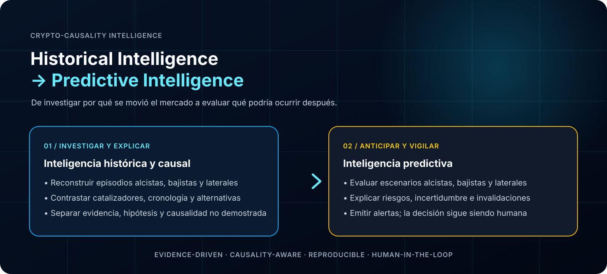
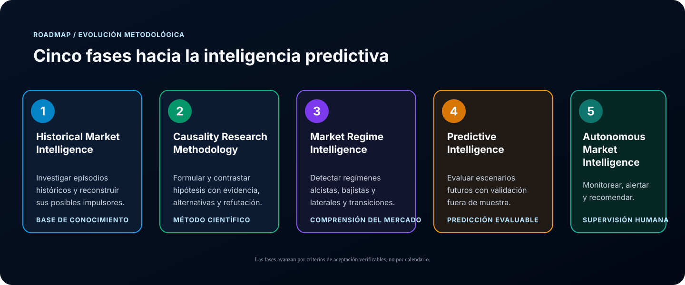

# Crypto-Causality Intelligence

  <strong>Historical Intelligence → Predictive Intelligence</strong> 
  Investigación basada en evidencias sobre los movimientos del mercado de criptomonedas, sus posibles impulsores, los cambios de régimen y los escenarios futuros.

## Objetivo estratégico

Desarrollar una metodología rigurosa de investigación y una plataforma inteligente que permita estudiar por qué se mueve el mercado de criptomonedas y, después de una validación histórica y *out-of-sample* suficiente, evaluar qué podría ocurrir a continuación.

El sistema estudiará los regímenes **alcistas, bajistas y laterales**, sus inicios, evolución, finales y transiciones. Deberá distinguir los hechos verificados de las hipótesis y de las coincidencias temporales; nunca presentará una correlación como prueba de causalidad.

  

  

### Capacidades que se buscan desarrollar

- Reconstruir episodios históricos del mercado y sus cronologías.
- Investigar posibles catalizadores, incluidas filtraciones, rumores, primeras publicaciones, anuncios oficiales y reacciones del mercado.
- Contrastar las explicaciones candidatas con evidencias contrarias e hipótesis alternativas.
- Detectar regímenes alcistas, bajistas y laterales, así como sus transiciones.
- Evaluar escenarios futuros indicando explícitamente la incertidumbre, los riesgos y las condiciones de invalidación.
- Monitorear los mercados y emitir alertas o recomendaciones sin ejecutar operaciones.

## Fases del proyecto

La hoja de ruta avanza desde la comprensión histórica hasta la inteligencia predictiva y semiautónoma del mercado. Cada fase deberá cumplir criterios de aceptación documentados y verificables antes de que el proyecto avance.

  

  

1. **Historical Market Intelligence** — construir una base de conocimiento fiable sobre episodios del mercado, regímenes de precios, acontecimientos y evidencias de las fuentes.
2. **Causality Research Methodology** — definir procedimientos reproducibles para formular, probar, cuestionar y clasificar hipótesis causales.
3. **Market Regime Intelligence** — identificar regímenes alcistas, bajistas y laterales, incluidas las transiciones entre ellos.
4. **Predictive Intelligence** — desarrollar y validar modelos de escenarios mediante evaluación *walk-forward* y *out-of-sample*, evitando *look-ahead bias* y *data leakage*.
5. **Autonomous Market Intelligence** — monitorear continuamente, reevaluar y generar alertas, manteniendo las decisiones de inversión bajo control humano.

## Cobertura y modelo operativo

| Dimensión | Política |
|---|---|
| Cobertura de activos | **ALL + SELECTED** — cubrir todos los activos que cumplan requisitos explícitos de calidad de datos, identidad, liquidez, disponibilidad histórica y evidencia; además de los activos seleccionados por el usuario para investigaciones más profundas. |
| Autonomía operativa | **SEMI-AUTONOMOUS** — recopilación automatizada de datos, monitoreo, apoyo a la investigación, detección de regímenes, evaluación de predicciones y generación de alertas. |
| Autoridad sobre operaciones | **Human-in-the-loop** — la plataforma no ejecutará compras ni ventas automáticamente. |
| Estándar de evidencia | Fuentes verificables, cronologías trazables, evidencias contrarias, explicaciones alternativas e incertidumbre explícita. |

## Principios fundamentales

- **Evidence-driven:** toda conclusión relevante debe poder rastrearse hasta sus evidencias.
- **Causality-aware:** la proximidad temporal y la correlación no bastan para demostrar causalidad.
- **Reproducible:** los procedimientos de investigación, entradas, versiones y resultados deben ser auditables.
- **Uncertainty-explicit:** la incertidumbre no cuantificada debe permanecer como tal; no se inventarán probabilidades ni puntuaciones de confianza.
- **Leakage-resistant:** la evaluación predictiva debe evitar *look-ahead bias* y *data leakage*.
- **Human-in-the-loop:** las recomendaciones y alertas sirven de apoyo a las decisiones; no ejecutan operaciones.

## Gobernanza y flujo de trabajo

Todas las preguntas, requisitos, investigaciones, decisiones y defectos del proyecto se registrarán mediante GitHub Issues. Los cambios se propondrán a través de Pull Requests vinculados, y deberán probarse y revisarse antes de integrarse en `main`.

**Issue → Pull Request → Validación → Merge**

Ninguna implementación se considerará terminada hasta que se hayan verificado sus criterios de aceptación y las evidencias correspondientes.

## Estado del proyecto

Este repositorio es el espacio oficial de **Crypto-Causality Intelligence**. La hoja de ruta describe la dirección prevista del proyecto; no significa que las capacidades futuras ya estén implementadas.
