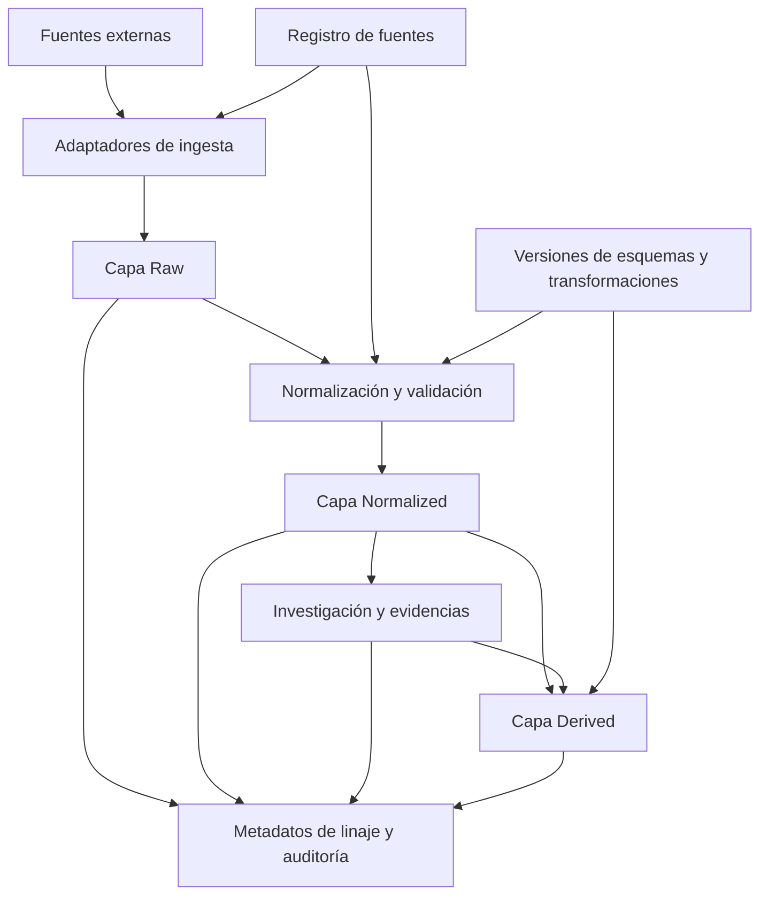

# Arquitectura de datos

## Propósito

Este documento define la arquitectura inicial de datos para **Historical Market Intelligence**. Se trata de un diseño lógico, no de un compromiso con una base de datos, proveedor cloud, API de exchange o topología de despliegue específicos.

La arquitectura debe preservar la fidelidad de las fuentes, la corrección temporal, la reproducibilidad y la separación entre hechos observados e interpretaciones de investigación.

## Principios arquitectónicos

1. **Preservar los originales:** los registros de origen en la capa raw son inmutables. Las correcciones generan nuevas versiones o registros de revisión de solo anexado.
2. **Separar responsabilidades:** las capas raw, normalized y derived tienen funciones diferenciadas.
3. **Preservar la procedencia:** cada registro normalizado o derivado debe poder rastrearse hasta sus registros de origen y la ejecución de transformación correspondiente.
4. **Respetar el tiempo:** distinguir cuándo ocurrió algo, cuándo se publicó y cuándo estuvo disponible para el sistema.
5. **Evitar acoplamientos prematuros:** los formatos específicos de cada fuente se gestionan mediante adapters; el modelo canónico es independiente del proveedor.
6. **Hacer explícita la incertidumbre:** los valores faltantes, estimados, disputados, provisionales y corregidos deben seguir siendo distinguibles.
7. **Investigación bajo supervisión humana:** los resultados sirven para investigar y apoyar decisiones; esta arquitectura no autoriza operaciones de trading automatizadas.

## Flujo lógico de datos

## Capas de datos

### Capa Raw

Almacena los payloads de origen o la representación más fiel permitida legalmente, junto con identificadores del proveedor y de sus registros nativos, marcas de tiempo de recuperación/captura, marcas de tiempo originales de publicación/evento, contexto de la solicitud, formato del payload, hash del contenido, identificador del lote de ingesta y restricciones de licencia/retención.

Los registros raw son de solo anexado. Si un proveedor corrige o vuelve a publicar un registro, se conserva la nueva observación y se vincula con la versión anterior, en lugar de reemplazarla silenciosamente.

### Capa Normalized

Contiene representaciones canónicas independientes de los esquemas específicos de cada proveedor: activos, exchanges, mercados, pares de trading, observaciones de mercado, eventos, documentos y metadatos de fuentes. La normalización no debe eliminar los valores nativos de la fuente. Cuando se requiera conversión o interpretación, deben conservarse los valores y unidades originales.

### Capa de investigación y evidencias

Representa evidencias vinculadas a registros de origen u observaciones de mercado; afirmaciones atribuidas a documentos, fuentes o analistas; hipótesis y explicaciones alternativas; evidencias de apoyo, contradicción o contexto; estado de revisión y justificación.

Una afirmación no se convierte automáticamente en un hecho verificado. Una hipótesis no es una observación.

### Capa Derived

Contiene resultados reproducibles, como agregados, features, ventanas de eventos, episodios de mercado, etiquetas de régimen y datasets de investigación. Cada resultado derivado debe registrar sus entradas, versión de la transformación, parámetros y tiempo de ejecución.

## Ingesta y procesamiento

Los adapters de fuentes recuperan datos y registran el contexto de cada solicitud. La validación se ejecuta antes de aceptar registros en la capa normalized. Los registros fallidos o puestos en cuarentena deben seguir siendo trazables; nunca deben desaparecer silenciosamente.

Cada ejecución de procesamiento debe identificar los IDs de los registros de entrada o un manifiesto estable de entradas, la versión del adapter, las versiones de esquema y transformación, los parámetros y versiones de datos de referencia, las marcas de tiempo y el estado de ejecución, las advertencias, los registros rechazados y los resultados de validación.

## Límites de almacenamiento y despliegue

El diseño inicial es modular y puede implementarse como un único sistema desplegable. Una base de datos relacional es una opción razonable para las entidades canónicas, relaciones y metadatos; el object storage puede ser adecuado para payloads raw de gran tamaño. Los sistemas time-series o analíticos solo deben evaluarse después de medir los requisitos de carga y escala.

Este documento no selecciona ninguna base de datos, message broker, lakehouse, topología de microservicios ni proveedor cloud.

## Seguridad, licencias y retención

Antes de la ingesta, deben registrarse los términos de uso aplicables, las restricciones de redistribución, los límites de retención, los rate limits y los requisitos de atribución. No se debe conservar ni redistribuir contenido más allá de los permisos aplicables. Las credenciales y los secretos nunca deben almacenarse en los metadatos de payloads raw ni incorporarse al repositorio.

## Fuera del alcance

- Integraciones productivas con múltiples proveedores.
- Selección definitiva de base de datos e infraestructura cloud.
- Entrenamiento de modelos predictivos o trading automatizado.
- Afirmaciones de causalidad basadas únicamente en correlación o proximidad temporal.
