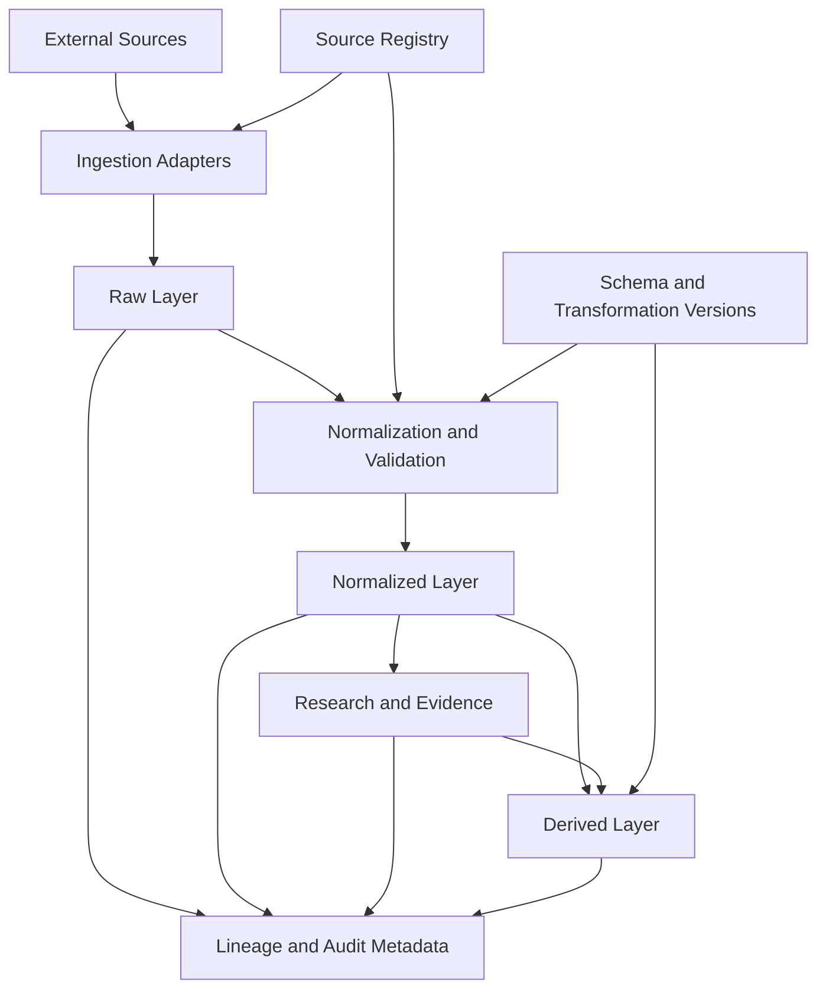

# Data Architecture

## Purpose

This document defines the initial data architecture for **Historical Market Intelligence**. It is a logical design, not a commitment to a specific database, cloud provider, exchange API, or deployment topology.

The architecture must preserve source fidelity, temporal correctness, reproducibility, and the separation between observed facts and research interpretations.

## Architectural principles

1. **Preserve originals:** raw source records are immutable. Corrections create new versions or append-only revision records.
2. **Separate concerns:** raw, normalized, and derived data have distinct responsibilities.
3. **Preserve provenance:** every normalized or derived record must be traceable to its source records and transformation run.
4. **Respect time:** distinguish when something happened, when it was published, and when it became available to the system.
5. **Avoid premature coupling:** source-specific formats are handled by adapters; the canonical model is provider-neutral.
6. **Make uncertainty explicit:** missing, estimated, disputed, provisional, and corrected values must remain distinguishable.
7. **Human-governed research:** outputs inform investigation and decisions; this architecture does not authorize automated trading.

## Logical data flow

## Data layers

### Raw layer

Stores source payloads or the most faithful legally permitted representation, together with source/provider identifiers, source-native record identifiers, retrieval/capture timestamps, original publication/event timestamps, request context, payload format, content hash, ingestion batch identifier, and license/retention restrictions.

Raw records are append-only. If a provider corrects or republishes a record, retain the new observation and link it to the prior version rather than silently replacing it.

### Normalized layer

Contains canonical representations independent of provider-specific schemas: assets, exchanges, markets, trading pairs, market observations, events, documents, and source metadata. Normalization must not erase source-native values. Preserve original values and units when conversion or interpretation is required.

### Research and evidence layer

Represents evidence linked to source records or market observations, claims attributed to documents/sources/analysts, hypotheses and competing explanations, supporting/contradicting/contextual evidence, review status, and rationale.

A claim is not automatically a verified fact. A hypothesis is not an observation.

### Derived layer

Contains reproducible outputs such as aggregates, features, event windows, market episodes, regime labels, and research datasets. Every derived output must record its inputs, transformation version, parameters, and execution time.

## Ingestion and processing

Source adapters retrieve data and record request context. Validation runs before normalized records are accepted. Failed or quarantined records remain traceable; they must not disappear silently.

A processing run should identify input record IDs or a stable input manifest, adapter/version, schema and transformation versions, parameters and reference-data versions, execution timestamps/status, warnings, rejected records, and validation outcomes.

## Storage and deployment boundaries

The initial design is modular and may be implemented as a single deployable system. A relational store is a reasonable candidate for canonical entities, relationships, and metadata; object storage may be suitable for large raw payloads. Time-series or analytical systems should be evaluated only after workload and scale requirements are measured.

No database, message broker, lakehouse, microservice topology, or cloud vendor is selected by this document.

## Security, licensing, and retention

Before ingestion, record applicable terms of use, redistribution restrictions, retention limits, rate limits, and attribution requirements. Do not retain or redistribute content beyond applicable permissions. Credentials and secrets must never be stored in raw payload metadata or committed to the repository.

## Out of scope

- Production integrations with multiple providers.
- Final database and cloud infrastructure selection.
- Predictive model training or automated trading.
- Claims of causality based solely on correlation or temporal proximity.
