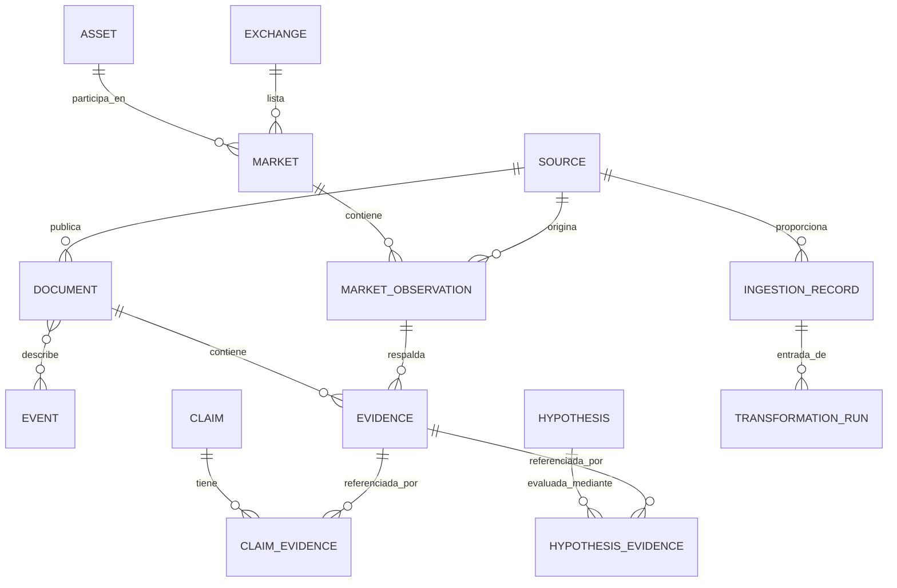

# Modelo conceptual de datos

## Propósito y alcance

Este documento define las entidades conceptuales independientes de proveedores que necesita **Historical Market Intelligence**. No prescribe un esquema físico ni exige que todas las entidades se implementen en la primera iteración.

## Grupos de entidades

### Identidad y estructura del mercado

| Entidad | Responsabilidad | Atributos importantes |
|---|---|---|
| `Asset` | Identifica un criptoactivo independientemente de la plataforma de trading | ID interno, nombre canónico, símbolos, identificadores de red/contrato, estado de identidad |
| `Exchange` | Identifica una plataforma de trading u operador de mercado | ID interno, nombre, jurisdicción cuando se conozca, identificadores oficiales |
| `Market` | Identifica un mercado específico de una plataforma | ID del exchange, ID nativo del mercado, ID del activo base, ID del activo cotizado, tipo y estado del mercado |
| `TradingPair` | Representa la relación base/cotización y sus convenciones | ID del activo base, ID del activo cotizado, notación canónica del par |

Los símbolos no son identificadores globalmente únicos. La identidad de un activo debe considerar redes, direcciones de contratos, migraciones, activos wrapped y tickers ambiguos. Los identificadores nativos de cada proveedor deben conservarse junto con los identificadores internos.

### Observaciones de mercado

| Entidad | Responsabilidad | Atributos importantes |
|---|---|---|
| `MarketObservation` | Almacena un valor medido para un mercado y un intervalo temporal | ID del mercado, métrica, valor, unidad, inicio/fin del intervalo, ID de la fuente, disponibilidad |
| `MetricDefinition` | Define el significado y la unidad de una métrica | nombre, unidad, metodología, semántica de agregación |

OHLCV puede representarse como una observación de vela o como un conjunto agrupado de métricas, siempre que la implementación física preserve la semántica de cada vela: open/high/low/close; volumen con unidad base/cotizada explícita; volumen cotizado y número de operaciones opcionales; límites del intervalo; identificadores de fuente/mercado/proveedor; estado final/provisional y linaje de revisiones.

La clave de una vela debe incluir la identidad de la plataforma/mercado, la definición del intervalo, el inicio del intervalo y la semántica de la métrica. Nunca deben combinarse implícitamente mercados de distintas plataformas o monedas de cotización.

### Información y eventos

| Entidad | Responsabilidad | Atributos importantes |
|---|---|---|
| `Source` | Describe un origen de información | ID de la fuente, categoría, operador, condición primaria/secundaria, metadatos de acceso y licencia |
| `Document` | Registra una publicación o contenido recuperable | ID de la fuente, ID nativo, URL/referencia, título, fecha de publicación, fecha de captura, hash del contenido |
| `Event` | Representa un acontecimiento bajo investigación | tipo, descripción, intervalo temporal del evento, precisión temporal, estado, entidades afectadas |
| `EventDocument` | Vincula documentos con eventos | ID del evento, ID del documento, tipo de relación, evaluación |

Un evento puede tener varios documentos y un documento puede tratar varios eventos. La hora de ocurrencia de un evento no debe inferirse automáticamente a partir de la fecha de publicación de un documento.

### Evidencia y razonamiento

| Entidad | Responsabilidad | Atributos importantes |
|---|---|---|
| `Evidence` | Elemento trazable relevante para una pregunta de investigación | tipo de evidencia, referencia al registro/documento de origen, fragmento o medición extraída, hora de disponibilidad |
| `Claim` | Proposición afirmada por una fuente o analista | enunciado, atribución, estado, alcance, contexto temporal |
| `Hypothesis` | Explicación propuesta que debe someterse a prueba | enunciado, mecanismo, alcance, supuestos, estado |
| `HypothesisEvidence` | Vincula evidencias con una hipótesis | ID de hipótesis, ID de evidencia, relación (apoya/contradice/contextualiza), justificación |
| `ClaimEvidence` | Vincula evidencias con una afirmación | ID de afirmación, ID de evidencia, relación y justificación |

Las afirmaciones y las hipótesis deben mantenerse diferenciadas de los registros de origen y las observaciones. Una evidencia puede apoyar, contradecir o simplemente aportar contexto a una hipótesis. El modelo debe preservar explicaciones alternativas y desacuerdos no resueltos.

### Linaje y gobernanza

| Entidad | Responsabilidad | Atributos importantes |
|---|---|---|
| `IngestionRecord` | Registra la recuperación de datos de origen | ID de fuente, horas de captura/ingesta, contexto de solicitud, estado, hash del payload |
| `DataRevision` | Registra correcciones o registros que sustituyen a otros | referencias a registros anterior/nuevo, motivo, hora observada |
| `TransformationRun` | Registra una operación de procesamiento reproducible | código/versión, versión del esquema, parámetros, manifiesto de entradas, referencias de salida |
| `SourceAssessment` | Documenta la calidad y las limitaciones de una fuente | criterios, evidencias, fecha de evaluación, revisor, justificación |

## Resumen de relaciones

El diagrama es conceptual; la implementación puede introducir entidades de asociación, claves compuestas o relaciones adicionales de linaje.

## Estrategia de identidad y claves

- Usar IDs internos estables para las entidades canónicas.
- Conservar todos los IDs nativos de las fuentes y su namespace de proveedor.
- No utilizar símbolos ticker, URLs ni nombres visibles como claves primarias.
- Modelar explícitamente los cambios de identificadores y las migraciones de activos cuando corresponda.
- Definir restricciones de unicidad solo dentro de un namespace y alcance documentados.
- Conservar las referencias a las fuentes originales después de resolver la entidad canónica.

## Orden mínimo de implementación

1. Registro de fuentes y metadatos de ingesta.
2. Identidad de activos, exchanges, mercados y pares de trading.
3. Observaciones de mercado y semántica temporal.
4. Documentos y eventos.
5. Evidencias, afirmaciones e hipótesis.
6. Revisiones, linaje de transformaciones y evaluaciones de fuentes.

Esta secuencia establece prioridades de implementación; no implica que deban omitirse entidades posteriores del diseño conceptual.
