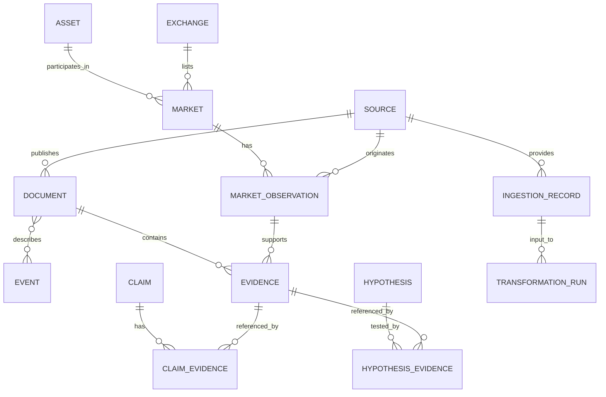

# Conceptual Data Model

## Purpose and scope

This document defines the provider-neutral conceptual entities required by **Historical Market Intelligence**. It does not prescribe a physical schema or require every entity to be implemented in the first iteration.

## Entity groups

### Identity and market structure

| Entity | Responsibility | Important attributes |
|---|---|---|
| `Asset` | Identifies a cryptoasset independently of a trading venue | internal ID, canonical name, symbols, network/contract identifiers, identity status |
| `Exchange` | Identifies a trading venue or market operator | internal ID, name, jurisdiction when known, official identifiers |
| `Market` | Identifies a venue-specific market | exchange ID, market-native ID, base asset ID, quote asset ID, market type, status |
| `TradingPair` | Represents the base/quote relationship and its conventions | base asset ID, quote asset ID, canonical pair notation |

Symbols are not globally unique identifiers. Asset identity must account for networks, contract addresses, migrations, wrapped assets, and ambiguous tickers. Provider-native identifiers must be retained alongside internal identifiers.

### Market observations

| Entity | Responsibility | Important attributes |
|---|---|---|
| `MarketObservation` | Stores a measured value for a market and time interval | market ID, metric, value, unit, interval start/end, source ID, availability |
| `MetricDefinition` | Defines the meaning and unit of a metric | name, unit, methodology, aggregation semantics |

OHLCV may be represented as a candle observation or as a grouped set of metrics, provided the physical implementation preserves candle-level semantics: open/high/low/close; volume with explicit base/quote unit; optional quote volume and trade count; interval boundaries; source/market/provider-native identifiers; final/provisional status and revision lineage.

A candle key must include venue/market identity, interval definition, interval start, and metric semantics. Different venues and quote currencies must never be merged implicitly.

### Information and events

| Entity | Responsibility | Important attributes |
|---|---|---|
| `Source` | Describes an origin of information | source ID, category, operator, primary/secondary status, access and license metadata |
| `Document` | Captures a publication or retrievable content item | source ID, native ID, URL/reference, title, published time, captured time, content hash |
| `Event` | Represents an occurrence being investigated | event type, description, event-time interval, time precision, status, affected entities |
| `EventDocument` | Links documents to events | event ID, document ID, relationship type, assessment |

An event may have multiple documents, and a document may discuss multiple events. The event's occurrence time must not be inferred automatically from its publication time.

### Evidence and reasoning

| Entity | Responsibility | Important attributes |
|---|---|---|
| `Evidence` | A traceable item relevant to a research question | evidence type, source record/document reference, extracted span or measurement, availability time |
| `Claim` | A proposition asserted by a source or analyst | statement, attribution, status, scope, temporal context |
| `Hypothesis` | A proposed explanation to be tested | statement, mechanism, scope, assumptions, status |
| `HypothesisEvidence` | Links evidence to a hypothesis | hypothesis ID, evidence ID, relation (supports/contradicts/contextualizes), rationale |
| `ClaimEvidence` | Links evidence to a claim | claim ID, evidence ID, relation and rationale |

Claims and hypotheses must remain distinct from source records and observations. Evidence may support, contradict, or merely contextualize a hypothesis. The model must preserve alternative explanations and unresolved disagreement.

### Lineage and governance

| Entity | Responsibility | Important attributes |
|---|---|---|
| `IngestionRecord` | Records retrieval of source data | source ID, captured/ingested times, request context, status, payload hash |
| `DataRevision` | Records corrections or superseding records | prior/new record references, reason, observed time |
| `TransformationRun` | Records a reproducible processing operation | code/version, schema version, parameters, input manifest, output references |
| `SourceAssessment` | Documents source quality and limitations | criteria, evidence, assessment date, reviewer, rationale |

## Relationship overview

The diagram is conceptual; implementation may introduce association entities, composite keys, or additional lineage relations.

## Identity and key strategy

- Use stable internal IDs for canonical entities.
- Preserve all source-native IDs and their provider namespace.
- Do not use ticker symbols, URLs, or display names as primary keys.
- Model identifier changes and asset migrations explicitly where relevant.
- Define uniqueness constraints only within a documented namespace and scope.
- Preserve raw source references after canonical entity resolution.

## Minimum viable implementation order

1. Source registry and ingestion metadata.
2. Asset, exchange, market, and trading-pair identity.
3. Market observations and temporal semantics.
4. Documents and events.
5. Evidence, claims, and hypotheses.
6. Revisions, transformation lineage, and source assessments.

This sequence is an implementation priority, not a reason to omit later entities from the conceptual design.
