# Modelo lógico de PostgreSQL — Crypto Causality Intelligence

- **Estado:** contrato lógico reconciliado v0.8; propuesta, no implementada.
- **Fecha:** 2026-11-06.
- **Decisión relacionada:** ADR-001.
- **Issue / PR:** #14 / #16.
- **Especificación física vinculada:** `postgresql-physical-schema.md` v0.7.

## 1. Propósito y límites

Este documento define el significado del dominio relacional y sus relaciones. La especificación física vinculada define los tipos PostgreSQL, nombres exactos de columnas, claves candidatas, restricciones, índices y reglas de implementación. Ambos documentos forman un único contrato: no se deben crear migraciones si divergen.

PostgreSQL mantiene catálogo, identidades, metadata, operaciones, autorizaciones evaluadas, procedencia, linaje e investigación. Los valores históricos de mercado permanecen fuera de PostgreSQL: los datasets autorizados se almacenan en Parquet y se consultan con DuckDB. Las pruebas del esquema usarán exclusivamente datos sintéticos.

## 2. Convenciones

- Las tablas y columnas físicas usan los nombres exactos en inglés y `snake_case` indicados aquí y en la especificación física.
- Identificadores internos UUID; instantes TIMESTAMPTZ interpretados en UTC; cantidades financieras NUMERIC; extensiones variables JSONB.
- Los intervalos de validez son semiabiertos `[valid_from, valid_until)`. En resolución de identidades, `recorded_at` es el instante inmutable de conocimiento de CCI; la historia bitemporal se reconstruye desde revisiones append-only y sus relaciones de sustitución, consultando `valid_at` y `known_at`.
- Se distinguen el tiempo de validez del dato, el tiempo de observación de evidencia y el tiempo en que CCI registró una decisión.
- Las entidades históricas y las decisiones de autorización son append-only desde los servicios autorizados.
- No se infiere identidad por ticker, alias, chain ID aislado ni dirección sin namespace/red.
- Las FKs históricas usan RESTRICT salvo excepción explícita para relaciones puramente asociativas.
- Los vocabularios y restricciones físicas son los definidos en la especificación física; no se permiten vocabularios divergentes entre capas.

## 3. Catálogo canónico de entidades

### 3.1 Fuentes, interfaces y políticas

**`data_sources`** — proveedor o sistema de origen. Atributos: `id`, `source_key`, `display_name`, `source_type`, `documentation_url`, `status`, `created_at`, `updated_at`. `source_key` identifica de forma estable al proveedor.

**`data_endpoints`** — producto/interfaz de datos de una fuente. Atributos: `id`, `data_source_id`, `endpoint_key`, `base_url`, `resource_path`, `data_type`, `documentation_url`, `status`, `created_at`. Un endpoint pertenece a una sola fuente; `(data_source_id, endpoint_key)` es único y `(id, data_source_id)` es clave candidata para integridad compuesta.

**`source_usage_policies`** — evidencia versionada de condiciones de uso. Atributos: `id`, `data_source_id`, `data_endpoint_id` nullable, `policy_scope`, `scope_reference` nullable, `intended_use`, `permission_status`, `evidence_url`, `evidence_reference`, `evidence_sha256`, `reviewed_at`, `valid_from`, `valid_until`, `retention_rule`, `notes`, `created_at`. El alcance puede ser proveedor, producto/plan, endpoint o tipo de dato. Para `product`, `scope_reference` identifica el producto/plan mediante una clave estable; para `data_type`, contiene el valor canónico del tipo; para `provider` y `endpoint` queda NULL. En alcance endpoint, `data_endpoint_id` debe identificar el endpoint de la misma fuente. Una modificación de evidencia crea otra fila.

**`policy_evaluations`** — decisión inmutable de aplicabilidad de una política a una contribución concreta. Atributos: `id`, `source_usage_policy_id`, `data_source_id`, `data_endpoint_id`, `data_type`, `intended_use`, `permission_status`, `evaluated_at`, `policy_valid_from_snapshot`, `policy_valid_until_snapshot`, `evidence_sha256`, `decision_reference`, `created_at`. Materializa el resultado, el tipo de dato, el uso, el endpoint y el snapshot de vigencia. La evaluación debe comprobar que la política cubra fuente, producto/plan cuando aplique, endpoint, tipo, uso e instante. Solo `allowed` habilita persistencia; la FK no sustituye esta decisión de negocio.

### 3.2 Activos, redes e instrumentos

**`identity_namespaces`** — catálogo inmutable de namespaces usados exclusivamente para resolver identidades de activos y representaciones. Atributos: `namespace_key`, `scope_mode` (`global|network`), `target_level` (`asset|representation|both`), `description`, `created_at`. La clave define una autoridad y un dominio de identificadores inequívocos. Cambiar alcance o semántica requiere una nueva clave; no se confunde con los namespaces de identificadores de red o de instrumentos.

**`assets`** — identidad canónica del activo económico/técnico, no de una representación concreta. Atributos: `id`, `canonical_code`, `display_name`, `asset_type`, `issuer_key`, `issuer_name`, `external_identifiers`, `created_at`. No contiene `network`.

**`networks`** — identidad canónica de una red. Atributos: `id`, `network_key`, `display_name`, `network_family`, `environment`, `created_at`.

**`network_identifiers`** — identificadores técnicos y externos namespaced de una red. Atributos: `id`, `network_id`, `namespace`, `identifier_type`, `identifier_value`, `observed_at`, `evidence_reference`, `provider_platform_id`, `provider_data_source_id`, `provider_platform_resolution_review_id`, `provider_platform_resolution_status`. Para identificadores de plataforma, FKs compuestas exigen coincidencia exacta de identidad de plataforma, proveedor, valor literal, revisión accepted y red de destino; los campos de procedencia son todos NULL para identificadores técnicos no originados en proveedor.

**`provider_platforms`** — identidad estable de una plataforma dentro de un proveedor. Atributos: `id`, `data_source_id`, `provider_platform_key`, `created_at`; UNIQUE por fuente + clave literal externa. No almacena snapshots ni metadata mutable.

**`provider_platform_observations`** — capturas inmutables de metadata. Atributos: `id`, `provider_platform_id`, `data_source_id`, `capture_id`, `observed_at`, `recorded_at`, `provider_name`, `provider_shortname`, `provider_native_coin_id`, `reported_chain_identifier_raw`, `reported_chain_identifier_json_type`, `evidence_reference`, `evidence_sha256`. UNIQUE por identidad + `capture_id`; timestamps iguales no colisionan.

**`provider_platform_resolution_reviews`** — cadena append-only de decisiones sobre la identidad estable. Atributos: `id`, `provider_platform_id`, `data_source_id`, `based_on_observation_id` nullable, `candidate_network_id`, `resolution_status`, `evidence_reference`, `decision_reference`, `reviewed_at`, `recorded_at`, `valid_from` obligatorio, `valid_until`, `supersedes_review_id`. Toda decisión, incluso pending, ambiguous o rejected, declara desde cuándo produce efecto; la revisión apunta a la identidad estable y opcionalmente a la observación que sustentó la decisión. `supersedes_review_id` solo representa corrección/revocación/sucesión de una decisión, nunca una captura nueva.

**`asset_representations`** — unidad nativa o despliegue contractual de un activo en una red. Atributos: `id`, `asset_id`, `network_id`, `representation_kind`, `native_asset_key`, `contract_address`, `address_normalization`, `token_standard`, `decimals`, `issuer_key`, `valid_from`, `valid_until`, `observed_at`, `evidence_reference`. Una representación pertenece a un activo y una red; los datos nativos y contractuales son mutuamente excluyentes.

**`asset_relationships`** — relación dirigida y evidenciada entre activos distintos. Atributos: `id`, `subject_asset_id`, `object_asset_id`, `relationship_type`, `directionality`, `valid_from`, `valid_until`, `evidence_reference`, `observed_at`, `recorded_at`. No establece equivalencia ni transitividad automática.

**`asset_identity_resolution_reviews`** — historial de decisiones de identidad. Atributos: `id`, `namespace` (FK a `identity_namespaces.namespace_key`), `network_id`, `external_identifier`, `candidate_asset_id`, `candidate_asset_representation_id`, `resolution_status`, `evidence_reference`, `decision_reference`, `observed_at`, `reviewed_at`, `recorded_at`, `valid_from`, `valid_until`, `supersedes_review_id`. Una decisión aceptada apunta exactamente a un activo o representación, nunca a ambos; una ambigüedad no se publica como mapping aceptado. Expone claves candidatas compuestas para que las tablas de mappings solo puedan referenciar revisiones accepted del mismo destino y clave externa. Las revisiones son append-only: `recorded_at` conserva el instante de conocimiento y `supersedes_review_id` permite reconstruir qué decisión conocía CCI en cada `known_at`; el periodo de aplicación se expresa con `[valid_from, valid_until)`. El registro asociado fija el alcance global o por red y el nivel de destino permitido; la revisión debe cumplir ambos.

**`asset_identifiers`** — mapping externo aceptado a nivel de activo. Atributos: `id`, `asset_id`, `namespace`, `external_identifier`, `network_id` nullable, `valid_from`, `valid_until`, `recorded_at`, `evidence_reference`, `resolution_review_id`, `resolution_status`. La FK compuesta exige que la revisión esté accepted y coincidan exactamente activo, namespace e identificador; un trigger compara el ámbito de red con igualdad NULL-safe.

**`asset_representation_identifiers`** — mapping externo aceptado a nivel de representación. Atributos: `id`, `asset_representation_id`, `network_id`, `namespace`, `external_identifier`, `valid_from`, `valid_until`, `recorded_at`, `evidence_reference`, `resolution_review_id`, `resolution_status`. FKs compuestas exigen coincidencia exacta de revisión accepted, representación, red, namespace e identificador.

**`market_instruments`** — identidad de un instrumento de mercado de una fuente. Atributos: `id`, `data_source_id`, `source_instrument_id`, `native_symbol`, `native_base_asset_code`, `native_quote_asset_code`, `base_asset_id`, `quote_asset_id`, `canonical_symbol`, `market_type`, `created_at`. Los activos canónicos base/cotizado pueden permanecer sin resolver (ambos NULL); si se resuelven, ambos deben existir y ser distintos. USD y USDT son activos diferentes.

**`instrument_identifiers`** — alias nativos por namespace/interfaz. Atributos: `id`, `market_instrument_id`, `identifier_namespace`, `identifier_value`, `is_primary`, `valid_from`, `valid_until`, `observed_at`, `created_at`. Los alias REST/WebSocket no se colapsan sin evidencia.

**`instrument_metadata_versions`** — observaciones históricas de metadata. Atributos: `id`, `market_instrument_id`, `source_dataset_id`, `observed_at`, `valid_from`, `valid_until`, `source_status`, `normalized_status`, `price_precision`, `quantity_precision`, `pair_decimals`, `lot_decimals`, `provider_metadata`, `mapping_version`, `schema_version`, `created_at`. `observed_at` es tiempo de conocimiento; `valid_from/valid_until` describen vigencia declarada.

**`instrument_trading_rules`** — reglas de negociación vinculadas a una versión de metadata. Atributos: `id`, `metadata_version_id`, `rule_namespace`, `rule_scope`, `parameters`, `applicability`, `created_at`. Los parámetros decimales se conservan como strings; no se sintetiza un step universal si el proveedor distingue ámbitos.

### 3.3 Ejecución y adquisición

**`ingestion_runs`** — ejecución lógica. Atributos: `id`, `run_key`, `started_at`, `finished_at`, `status`, `code_version`, `protocol_version`, `configuration`, `trigger_type`, `notes`, `created_at`. Una ejecución terminal no se reabre.

**`ingestion_requests`** — intento de adquisición de un endpoint dentro de un Run. Atributos: `id`, `ingestion_run_id`, `data_source_id`, `data_endpoint_id`, `market_instrument_id`, `attempt_number`, `requested_at`, `completed_at`, `http_status`, `response_status`, `request_parameters`, `response_headers_safe`, `response_hash`, `records_received`, `error_code`, `error_message`, `created_at`. La fuente redundante permite imponer FKs compuestas que impiden mezclar endpoint e instrumento de proveedores distintos. No se almacenan cuerpos de respuesta ni secretos.

### 3.4 Datasets, procedencia y linaje

**`datasets`** — artefacto lógico versionado. Atributos: `id`, `dataset_key`, `version`, `stage`, `data_format`, `schema_name`, `schema_version`, `storage_uri`, `checksum_sha256`, `file_size_bytes`, `record_count`, `time_start`, `time_end`, `created_at`, `retention_status`, `metadata`. La versión publicada es inmutable; la eliminación de Parquet puede dejar un tombstone mínimo permitido.

**`run_datasets`** — asociación entre Run y dataset. Atributos: `ingestion_run_id`, `dataset_id`, `dataset_role`, `created_at`. Su PK es `(ingestion_run_id, dataset_id, dataset_role)`. No sustituye ni la procedencia ni el linaje.

**`dataset_sources`** — contribución de una fuente a un dataset. Atributos: `id`, `dataset_id`, `data_source_id`, `data_endpoint_id`, `data_type`, `market_instrument_id`, `ingestion_request_id`, `policy_evaluation_id`, `evaluated_intended_use`, `created_at`. Cada fila identifica una contribución coherente y referencia la evaluación concreta de la misma fuente, endpoint, tipo de dato y uso. `data_type` forma parte de la clave referencial compuesta hacia `policy_evaluations`; no puede quedar implícito ni diferir de la evaluación. Para una contribución sin solicitud, `ingestion_request_id` es NULL; cuando existe, su fuente y endpoint deben coincidir.

**`dataset_lineage`** — dependencia dirigida entre datasets. Atributos: `input_dataset_id`, `output_dataset_id`, `transformation_run_id`, `created_at`. PK compuesta por las tres claves; se prohíben auto-relaciones y los ciclos se previenen transaccionalmente.

### 3.5 Validación, transformación e investigación

**`data_validations`** — resultado histórico de una suite sobre un dataset. Atributos: `id`, `dataset_id`, `ingestion_run_id`, `validation_suite`, `validation_version`, `status`, `checked_at`, `checks_total`, `checks_passed`, `checks_failed`, `report_uri`, `report_hash`, `details`, `created_at`.

**`transformations`** — definición versionada. Atributos: `id`, `transformation_key`, `version`, `description`, `code_reference`, `parameters_schema`, `created_at`.

**`transformation_runs`** — ejecución concreta. Atributos: `id`, `transformation_id`, `ingestion_run_id`, `started_at`, `finished_at`, `status`, `parameters`, `code_commit`, `error_summary`, `created_at`.

**`research_experiments`** — experimento reproducible. Atributos: `id`, `experiment_key`, `title`, `objective`, `methodology_version`, `status`, `started_at`, `finished_at`, `code_version`, `protocol`, `conclusion_summary`, `created_at`.

**`research_experiment_runs`** — ejecución individual e inmutable en su identidad. Atributos: `id`, `experiment_id`, `run_key`, `status`, `code_commit`, `protocol_version`, `parameters`, `input_manifest`, `metrics`, `started_at`, `finished_at`, `error_code`, `error_summary`, `created_at`. Un experimento tiene cero o muchos runs; cada run pertenece a exactamente un experimento.

**`research_run_artifacts`** — referencias a artefactos externos asociados a un run. Atributos: `id`, `run_id`, `artifact_role`, `logical_uri`, `media_type`, `format`, `sha256`, `byte_size`, `schema_version`, `retention_class`, `created_at`. Guarda metadatos y hashes, nunca el contenido binario ni las series OHLCV.

**`research_hypotheses`** — hipótesis y criterios de falsación. Atributos: `id`, `experiment_id`, `hypothesis_key`, `statement`, `alternative_explanations`, `falsification_criteria`, `status`, `created_at`.

**`experiment_datasets`** — asociación experimento/dataset/rol. Atributos: `experiment_id`, `dataset_id`, `dataset_role`, `created_at`.

## 4. Relaciones e integridad que forman parte del contrato

1. Fuente → endpoints, políticas, instrumentos y solicitudes; cada endpoint e instrumento pertenece a una fuente.
2. Política → evaluaciones; cada evaluación referencia la política de la misma fuente y el endpoint de esa fuente.
3. Evaluación → contribución de dataset mediante coincidencia exacta de fuente, endpoint, tipo de dato y uso previsto.
4. Run → solicitudes y, mediante `run_datasets`, datasets producidos/registrados.
5. Activo → representaciones; representación → red; red → identificadores namespaced. Proveedor → identidad estable de plataforma → observaciones inmutables y revisiones append-only → red; solo revisiones accepted pueden publicar identificadores de proveedor en `network_identifiers`.
6. Instrumento → versiones de metadata → reglas de negociación.
7. Dataset → procedencias, validaciones, linaje y asociaciones con experimentos.
8. Transformación → ejecuciones; cada arista de linaje referencia una ejecución concreta.
10. Experimento → runs de investigación → referencias a artefactos; los runs analíticos no reutilizan las ejecuciones de ingesta ni de transformación.
9. Revisión de identidad accepted → mapping del mismo destino, red (cuando aplique), namespace e identificador; las FKs compuestas garantizan destino y estado, y el trigger garantiza el ámbito nullable de red en mappings de activo.
10. Las FKs compuestas de la especificación física son obligatorias cuando garantizan coherencia de fuente/endpoint/instrumento/política. No pueden sustituirse por validaciones solo en Python.

Las restricciones locales incluyen intervalos temporales válidos, marcas de tiempo de finalización no anteriores al inicio, intentos positivos, contadores y tamaños no negativos, hashes SHA-256 con formato definido y estados dentro de vocabularios controlados. Los solapamientos temporales, ciclos de linaje, transiciones de estado y decisiones de aplicabilidad requieren lógica transaccional adicional cuando un CHECK/FK no sea suficiente.

## 5. Diagrama de relaciones

```mermaid
erDiagram
    DATA_SOURCES ||--o{ DATA_ENDPOINTS : exposes
    DATA_SOURCES ||--o{ SOURCE_USAGE_POLICIES : governed_by
    SOURCE_USAGE_POLICIES ||--o{ POLICY_EVALUATIONS : evaluated_as
    DATA_ENDPOINTS ||--o{ POLICY_EVALUATIONS : scoped_to
    DATA_SOURCES ||--o{ MARKET_INSTRUMENTS : lists
    ASSETS ||--o{ ASSET_REPRESENTATIONS : represented_by
    NETWORKS ||--o{ ASSET_REPRESENTATIONS : hosts
    NETWORKS ||--o{ NETWORK_IDENTIFIERS : identified_by
    DATA_SOURCES ||--o{ PROVIDER_PLATFORMS : identifies
    PROVIDER_PLATFORMS ||--o{ PROVIDER_PLATFORM_OBSERVATIONS : observed_in
    PROVIDER_PLATFORMS ||--o{ PROVIDER_PLATFORM_RESOLUTION_REVIEWS : reviewed_as
    PROVIDER_PLATFORM_OBSERVATIONS o|--o{ PROVIDER_PLATFORM_RESOLUTION_REVIEWS : supports
    NETWORKS ||--o{ PROVIDER_PLATFORM_RESOLUTION_REVIEWS : candidate_network
    IDENTITY_NAMESPACES ||--o{ ASSET_IDENTITY_RESOLUTION_REVIEWS : governs
    ASSETS ||--o{ ASSET_IDENTIFIERS : identified_by
    ASSET_REPRESENTATIONS ||--o{ ASSET_REPRESENTATION_IDENTIFIERS : identified_by
    ASSETS ||--o{ ASSET_RELATIONSHIPS : related
    MARKET_INSTRUMENTS ||--o{ INSTRUMENT_IDENTIFIERS : aliases
    MARKET_INSTRUMENTS ||--o{ INSTRUMENT_METADATA_VERSIONS : observed
    INSTRUMENT_METADATA_VERSIONS ||--o{ INSTRUMENT_TRADING_RULES : defines
    INGESTION_RUNS ||--o{ INGESTION_REQUESTS : contains
    DATA_ENDPOINTS ||--o{ INGESTION_REQUESTS : requested_from
    INGESTION_RUNS ||--o{ RUN_DATASETS : registers
    DATASETS ||--o{ RUN_DATASETS : registered
    DATASETS ||--o{ DATASET_SOURCES : provenance
    POLICY_EVALUATIONS ||--o{ DATASET_SOURCES : authorizes
    DATASETS ||--o{ DATA_VALIDATIONS : validated
    TRANSFORMATIONS ||--o{ TRANSFORMATION_RUNS : executed
    TRANSFORMATION_RUNS ||--o{ DATASET_LINEAGE : produces
    DATASETS ||--o{ DATASET_LINEAGE : input_output
    RESEARCH_EXPERIMENTS ||--o{ RESEARCH_HYPOTHESES : tests
    RESEARCH_EXPERIMENTS ||--o{ EXPERIMENT_DATASETS : uses
    DATASETS ||--o{ EXPERIMENT_DATASETS : included
```

El diagrama muestra relaciones conceptuales; nulabilidad, claves compuestas y restricciones exactas se definen en la especificación física.

## 6. Criterios de aceptación previos a migraciones

- El inventario de entidades de este documento coincide exactamente con el inventario físico, incluidas `identity_namespaces`, `provider_platforms`, `provider_platform_observations` y `provider_platform_resolution_reviews`.
- Cada atributo lógico tiene correspondencia física; no quedan atributos obsoletos como `assets.network` ni `dataset_sources.source_usage_policy_id`.
- `dataset_sources.data_type` forma parte de la FK compuesta a `policy_evaluations`.
- El alcance de producto/plan y de tipo de dato en `source_usage_policies` tiene referencia estructurada y CHECKs coherentes.
- Las FKs compuestas impiden cruces incompatibles entre fuentes, endpoints, instrumentos, solicitudes y evaluaciones.
- El diagrama, el diccionario lógico y la especificación física describen las mismas relaciones.
- Las reglas temporales, estados, borrado e inmutabilidad están definidas con claridad.
- La implementación desde cero supera pruebas reales en PostgreSQL con fixtures sintéticos. Las pruebas Python de contratos no satisfacen este criterio.

## 7. Fuera de alcance

Este contrato no crea DDL, migraciones, infraestructura ni credenciales. Tampoco autoriza persistir datos de mercado de terceros. La siguiente fase, una vez aprobada la reconciliación documental, será generar DDL y probarlo en una instancia PostgreSQL temporal con datos exclusivamente sintéticos.

### 3.2.1 Namespaces iniciales y separación de dominios externos

La revisión documental de CoinGecko permite definir dos namespaces candidatos: `coingecko:coin_id` (global, destino `asset`, campo `id` de `/coins/list`) y `coingecko:contract_address` (por red, destino `representation`, direcciones bajo `platforms`). El primero identifica un registro del catálogo de CoinGecko, no una identidad económica universal; el segundo identifica una representación contractual y exige resolver el ID de plataforma a una entidad interna `networks` con evidencia independiente.

Los campos Binance Spot `baseAsset`/`quoteAsset` y Kraken Spot `base_asset`/`quote_asset` son códigos de activo dentro de metadata de pares. No se aceptan como namespaces canónicos de activos sin evidencia adicional de unicidad, estabilidad y semántica. Los símbolos de pares y alias REST/WebSocket se registran en `market_instruments` e `instrument_identifiers`. Los códigos nativos permanecen como metadata del instrumento hasta una resolución explícita; nunca se deduce equivalencia por ticker.

La aprobación de los namespaces CoinGecko es documental y no equivale a poblar `identity_namespaces`, validar todos los valores ni probar su estabilidad temporal. Véase la sección 9 de `postgresql-physical-schema.md` para la matriz de decisión y evidencia.

### 3.2.2 Resolución de plataformas de proveedores y redes

La identidad de red canónica pertenece a `networks.network_key`. El modelo separa tres hechos: `provider_platforms` identifica de forma estable la plataforma externa dentro de un proveedor; `provider_platform_observations` conserva snapshots inmutables; `provider_platform_resolution_reviews` registra decisiones sobre la identidad estable.

Para CoinGecko, `asset_platforms[].id` se conserva como `provider_platform_key`, no como clave canónica. `chain_identifier` puede ser NULL y, aun cuando exista, es un valor reportado, no prueba suficiente de identidad. La documentación oficial del endpoint declara `number | null`; se conserva como escalar JSONB exacto, sin imponer integer ni usar tipos aproximados. El cuerpo HTTP/evidencia con hash permite preservar el lexema original.

Una observación nueva no crea ni sustituye automáticamente una revisión. La revisión apunta a la identidad estable y puede señalar `based_on_observation_id` como evidencia. `supersedes_review_id` se reserva exclusivamente para corregir, revocar o sustituir una decisión anterior. `observed_at`, `recorded_at` y `valid_from/valid_until` conservan semánticas independientes. La política EVM/Solana se rige por `network-identity-resolution-policy.md`.

La ampliación del contrato lógico es documental. Las FKs, índices parciales, triggers, vista temporal, publicación atómica y matriz de pruebas del motor se especifican en `postgresql-physical-schema.md`, sección 13. No se ha poblado el catálogo ni se han aprobado correspondencias reales.
