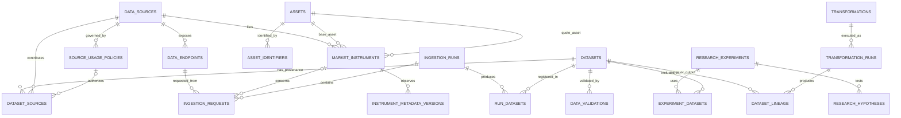

# Modelo lógico de PostgreSQL — Crypto Causality Intelligence

- **Estado:** Propuesta revisada v0.2; no implementada.
- **Fecha:** 2026-11-06.
- **Decisión relacionada:** ADR-001.
- **Issue relacionado:** #14.
- **PR de trabajo:** #15.

## 1. Propósito y límites

Este documento define el modelo lógico del catálogo relacional y del registro operativo. No define todavía migraciones SQL, índices físicos definitivos, despliegue ni credenciales.

PostgreSQL registrará fuentes, instrumentos, ejecuciones, solicitudes, datasets, validaciones, transformaciones y experimentos. Los valores históricos de mercado no se almacenarán como tablas OHLCV duplicadas: los datasets se conservarán en Parquet cuando la persistencia esté autorizada. DuckDB consultará esos archivos.

El modelo debe permitir rastrear una conclusión de investigación hasta los datasets utilizados, las transformaciones aplicadas y las ejecuciones que obtuvieron los datos.

## 2. Convenciones generales

- Identificadores internos: UUID generados por la aplicación o por PostgreSQL.
- Fechas y horas: TIMESTAMPTZ; los instantes canónicos se expresan en UTC.
- Cantidades, precios y volúmenes: NUMERIC cuando se almacenen metadatos numéricos operativos. No usar FLOAT para valores financieros que requieran exactitud decimal.
- Datos flexibles no centrales: JSONB, con validación de aplicación y sin secretos ni credenciales.
- Estados: texto restringido mediante CHECK inicialmente; evitar enums nativos hasta que el vocabulario sea estable.
- Nombres técnicos de tablas y columnas: snake_case, en inglés.
- Los identificadores externos de proveedores se conservarán junto con el identificador interno; nunca se asumirá que un símbolo es globalmente único.
- Las relaciones históricas relevantes no se sobrescribirán: los cambios de condiciones, metadatos o permisos deben quedar fechados y trazables.
- Las tablas operativas incluirán created_at y, cuando tenga sentido, updated_at.

## 3. Dominios y entidades

### 3.1 Registro de fuentes

#### data_sources

Un proveedor o sistema de origen, por ejemplo Binance Spot, Kraken Spot o CoinGecko.

Campos principales:
- id UUID PK
- source_key TEXT UNIQUE NOT NULL: identificador interno estable, por ejemplo binance_spot.
- display_name TEXT NOT NULL
- source_type TEXT NOT NULL: exchange, aggregator, on_chain, news, calendar u otro valor controlado.
- documentation_url TEXT
- status TEXT NOT NULL: active, paused, deprecated.
- created_at TIMESTAMPTZ NOT NULL
- updated_at TIMESTAMPTZ NOT NULL

Restricciones: source_key no cambia cuando cambia el nombre comercial. Una fuente retirada no se elimina si existen ejecuciones o datasets que la referencian.

#### data_endpoints

Representa una interfaz o producto de datos concreto de una fuente. No equivale necesariamente a una URL única: puede representar una familia de endpoints con semántica y condiciones comunes.

Campos principales:
- id UUID PK
- data_source_id UUID FK → data_sources.id
- endpoint_key TEXT NOT NULL
- base_url TEXT
- resource_path TEXT
- data_type TEXT NOT NULL: ohlcv, trades, ticker, market_metadata, aggregate_price, news, event, calendar, etc.
- documentation_url TEXT
- status TEXT NOT NULL
- created_at TIMESTAMPTZ NOT NULL

Restricción única: (data_source_id, endpoint_key). No guardar API keys, tokens ni cabeceras de autenticación.

#### source_usage_policies

Registra la evidencia y el alcance de las condiciones de uso, almacenamiento y retención. Separa la fuente técnica de la autorización para un uso concreto.

Campos principales:
- id UUID PK
- data_source_id UUID FK → data_sources.id
- data_endpoint_id UUID NULL FK → data_endpoints.id
- policy_scope TEXT NOT NULL: provider, product, endpoint o data_type.
- intended_use TEXT NOT NULL: private_research, public_display, redistribution, commercial_use, etc.
- permission_status TEXT NOT NULL: allowed, restricted, denied, unknown, pending_confirmation.
- evidence_url TEXT
- evidence_reference TEXT
- reviewed_at TIMESTAMPTZ
- valid_from TIMESTAMPTZ
- valid_until TIMESTAMPTZ NULL
- retention_rule TEXT
- notes TEXT
- created_at TIMESTAMPTZ NOT NULL

Regla crítica: una política desconocida, vencida o no aplicable al endpoint, tipo de dato y uso solicitado no habilita persistencia. La evaluación debe ser de denegación por defecto: una política general del proveedor no se interpretará automáticamente como autorización específica del endpoint o producto. La aplicación debe resolver y registrar la política aplicable antes de escribir valores en Parquet. Los cambios de política generan nuevos registros; no se reescribe la evidencia anterior.

### 3.2 Catálogo de activos e instrumentos

#### assets

Identidad canónica de un activo, independientemente de cómo lo nombre cada proveedor.

Campos principales:
- id UUID PK
- canonical_code TEXT UNIQUE NOT NULL: código interno estable, no necesariamente el ticker.
- display_name TEXT NOT NULL
- asset_type TEXT NOT NULL: crypto, fiat, stablecoin, tokenized_asset u otro tipo controlado.
- network TEXT NULL
- external_identifiers JSONB NOT NULL DEFAULT '{}'
- created_at TIMESTAMPTZ NOT NULL

No se debe identificar un activo únicamente por su ticker. Cuando la identidad sea ambigua, se mantendrá sin resolver hasta disponer de evidencia suficiente.

#### asset_identifiers

Identificadores externos de un activo dentro del namespace de un proveedor o red.

Campos principales:
- id UUID PK
- asset_id UUID FK → assets.id
- namespace TEXT NOT NULL
- network TEXT NULL
- external_identifier TEXT NOT NULL
- valid_from TIMESTAMPTZ NULL
- valid_until TIMESTAMPTZ NULL
- evidence_reference TEXT NULL
- created_at TIMESTAMPTZ NOT NULL

Restricción única propuesta: (namespace, network, external_identifier, valid_from). La aplicación debe validar solapamientos de vigencia; no asumir que un identificador externo sin namespace es globalmente único.

#### market_instruments

Representa un instrumento negociado en un mercado concreto de un proveedor.

Campos principales:
- id UUID PK
- data_source_id UUID FK → data_sources.id
- external_instrument_id TEXT NULL
- native_symbol TEXT NOT NULL
- base_asset_id UUID FK → assets.id
- quote_asset_id UUID FK → assets.id
- market_type TEXT NOT NULL: spot, perpetual, future, option u otro valor controlado.
- instrument_status TEXT NOT NULL
- valid_from TIMESTAMPTZ NULL
- valid_until TIMESTAMPTZ NULL
- metadata JSONB NOT NULL DEFAULT '{}'
- created_at TIMESTAMPTZ NOT NULL

La identidad de un instrumento es específica del proveedor y mercado. La restricción única definitiva debe considerar el segmento/mercado y la vigencia; no asumir que (data_source_id, native_symbol, market_type) basta para todos los proveedores. Se conserva la distinción entre cotizaciones como USD y USDT.

#### instrument_metadata_versions

Historial inmutable de observaciones y versiones de metadata de un instrumento.

Campos principales:
- id UUID PK
- market_instrument_id UUID FK → market_instruments.id
- source_dataset_id UUID NULL FK → datasets.id
- observed_at TIMESTAMPTZ NOT NULL
- valid_from TIMESTAMPTZ NULL
- valid_until TIMESTAMPTZ NULL
- instrument_status TEXT NOT NULL
- metadata JSONB NOT NULL DEFAULT '{}'
- created_at TIMESTAMPTZ NOT NULL

Separar el tiempo de observación (cuándo el proyecto conoció el valor) del tiempo de validez (cuándo la regla aplica en el mercado). Las nuevas observaciones generan nuevas filas; no sobrescribir versiones anteriores.

### 3.3 Adquisición y ejecución

#### ingestion_runs

Una ejecución lógica de adquisición, equivalente a un Run del proyecto.

Campos principales:
- id UUID PK
- run_key TEXT UNIQUE NOT NULL: identificador legible, por ejemplo run-014.
- started_at TIMESTAMPTZ NOT NULL
- finished_at TIMESTAMPTZ NULL
- status TEXT NOT NULL: queued, running, succeeded, partial, failed, cancelled.
- code_version TEXT
- protocol_version TEXT
- configuration JSONB NOT NULL DEFAULT '{}'
- trigger_type TEXT
- notes TEXT
- created_at TIMESTAMPTZ NOT NULL

La configuración almacenada debe excluir secretos y datos sensibles. Una ejecución finalizada no se edita para cambiar su resultado; las correcciones se registran como nuevas ejecuciones o eventos de auditoría.

#### ingestion_requests

Una solicitud HTTP/API o intento de adquisición ejecutado dentro de un Run.

Campos principales:
- id UUID PK
- ingestion_run_id UUID FK → ingestion_runs.id
- data_endpoint_id UUID FK → data_endpoints.id
- market_instrument_id UUID NULL FK → market_instruments.id
- attempt_number INTEGER NOT NULL
- requested_at TIMESTAMPTZ NOT NULL
- completed_at TIMESTAMPTZ NULL
- http_status INTEGER NULL
- response_status TEXT NOT NULL: succeeded, rate_limited, rejected, timeout, network_error, invalid_response.
- request_parameters JSONB NOT NULL DEFAULT '{}'
- response_headers_safe JSONB NOT NULL DEFAULT '{}'
- response_hash TEXT NULL
- records_received BIGINT NULL
- error_code TEXT NULL
- error_message TEXT NULL

No almacenar cuerpos de respuesta en PostgreSQL. Si una respuesta original puede conservarse legalmente, se gestiona como artefacto con política y procedencia explícitas. Restricción única propuesta: (ingestion_run_id, data_endpoint_id, attempt_number, requested_at).

### 3.4 Catálogo de datasets y trazabilidad

#### datasets

Un artefacto lógico versionado, que puede corresponder a una captura original autorizada, datos normalizados o datos derivados.

Campos principales:
- id UUID PK
- dataset_key TEXT NOT NULL
- version INTEGER NOT NULL
- stage TEXT NOT NULL: source_capture, normalized, derived, analytical_result.
- data_format TEXT NOT NULL: parquet, json, csv u otro formato permitido por la política.
- schema_name TEXT NOT NULL
- schema_version TEXT NOT NULL
- storage_uri TEXT NOT NULL: ruta lógica; no presupone almacenamiento cloud.
- checksum_sha256 TEXT NOT NULL
- file_size_bytes BIGINT NULL
- record_count BIGINT NULL
- time_start TIMESTAMPTZ NULL
- time_end TIMESTAMPTZ NULL
- created_at TIMESTAMPTZ NOT NULL
- retention_status TEXT NOT NULL: active, pending_review, expired, deletion_pending, deleted.
- metadata JSONB NOT NULL DEFAULT '{}'

Restricciones: (dataset_key, version) único; tamaño y conteo no negativos; time_end posterior a time_start cuando ambos existan. El registro puede conservarse como tombstone después de eliminar un archivo, sin retener los valores eliminados.

#### run_datasets

Relación explícita entre una ejecución y los datasets que produjo o registró. Es independiente de la procedencia de proveedores y del linaje de transformaciones.

Campos principales:
- ingestion_run_id UUID FK → ingestion_runs.id
- dataset_id UUID FK → datasets.id
- dataset_role TEXT NOT NULL: source_capture, normalized, validation_report, derived, analytical_result.
- created_at TIMESTAMPTZ NOT NULL

Clave primaria: (ingestion_run_id, dataset_id, dataset_role). El vocabulario de roles se restringirá mediante CHECK o catálogo controlado.

#### dataset_sources

Relación muchos-a-muchos entre datasets y las fuentes/endpoints que contribuyeron a ellos.

Campos:
- id UUID PK
- dataset_id UUID FK → datasets.id
- data_source_id UUID FK → data_sources.id
- data_endpoint_id UUID NULL FK → data_endpoints.id
- market_instrument_id UUID NULL FK → market_instruments.id
- ingestion_request_id UUID NULL FK → ingestion_requests.id
- source_usage_policy_id UUID NULL FK → source_usage_policies.id
- evaluated_intended_use TEXT NOT NULL
- permission_evaluated_at TIMESTAMPTZ NOT NULL
- Restricción de unicidad parcial para evitar duplicar la misma relación cuando exista ingestion_request_id; las filas sin solicitud se controlan mediante una clave de procedencia explícita.

La política referenciada debe ser la que la aplicación evaluó para esa contribución y uso. La FK no demuestra por sí sola que la política estuviera vigente o autorizara la persistencia; la decisión debe comprobarse antes de escribir el artefacto y conservar evidencia suficiente para auditarla.

Permite datasets derivados de más de una fuente sin ocultar la procedencia. No se mezclan proveedores en la capa original; una combinación, si se realiza, pertenece a la capa derivada y documenta cada entrada.

#### dataset_lineage

Registra relaciones entre datasets de entrada y salida.

Campos:
- input_dataset_id UUID FK → datasets.id
- output_dataset_id UUID FK → datasets.id
- transformation_run_id UUID FK → transformation_runs.id
- created_at TIMESTAMPTZ NOT NULL

Clave primaria compuesta: (input_dataset_id, output_dataset_id, transformation_run_id). Se prohíbe que un dataset sea su propio antecesor. La aplicación debe prevenir ciclos en el grafo de linaje.

### 3.5 Validaciones y transformaciones

#### data_validations

Una ejecución de un conjunto de controles sobre un dataset.

Campos principales:
- id UUID PK
- dataset_id UUID FK → datasets.id
- ingestion_run_id UUID NULL FK → ingestion_runs.id
- validation_suite TEXT NOT NULL
- validation_version TEXT NOT NULL
- status TEXT NOT NULL: passed, failed, warning, skipped.
- checked_at TIMESTAMPTZ NOT NULL
- checks_total INTEGER NOT NULL
- checks_passed INTEGER NOT NULL
- checks_failed INTEGER NOT NULL
- report_uri TEXT NULL
- report_hash TEXT NULL
- details JSONB NOT NULL DEFAULT '{}'

Los detalles deben permitir distinguir duplicados, huecos, desalineación temporal, cobertura, violaciones OHLC/volumen y otros controles aplicables. Los resultados de validación son históricos y no se sobrescriben.

#### transformations

Define una transformación versionada, no cada ejecución individual.

Campos principales:
- id UUID PK
- transformation_key TEXT NOT NULL
- version TEXT NOT NULL
- description TEXT NOT NULL
- code_reference TEXT
- parameters_schema JSONB NOT NULL DEFAULT '{}'
- created_at TIMESTAMPTZ NOT NULL

Restricción única: (transformation_key, version).

#### transformation_runs

Una ejecución concreta de una transformación.

Campos principales:
- id UUID PK
- transformation_id UUID FK → transformations.id
- ingestion_run_id UUID NULL FK → ingestion_runs.id
- started_at TIMESTAMPTZ NOT NULL
- finished_at TIMESTAMPTZ NULL
- status TEXT NOT NULL
- parameters JSONB NOT NULL DEFAULT '{}'
- code_commit TEXT
- error_summary TEXT NULL

Los datasets de entrada y salida se relacionan mediante dataset_lineage, que referencia la ejecución concreta de la transformación (transformation_run_id), no solamente su definición versionada.

### 3.6 Investigación

#### research_experiments

Una investigación reproducible con objetivo, protocolo y estado propios.

Campos principales:
- id UUID PK
- experiment_key TEXT UNIQUE NOT NULL
- title TEXT NOT NULL
- objective TEXT NOT NULL
- methodology_version TEXT
- status TEXT NOT NULL: planned, running, completed, inconclusive, rejected.
- started_at TIMESTAMPTZ NULL
- finished_at TIMESTAMPTZ NULL
- code_version TEXT
- protocol JSONB NOT NULL DEFAULT '{}'
- conclusion_summary TEXT NULL
- created_at TIMESTAMPTZ NOT NULL

#### research_hypotheses

Hipótesis explícitas asociadas a un experimento.

Campos principales:
- id UUID PK
- experiment_id UUID FK → research_experiments.id
- hypothesis_key TEXT NOT NULL
- statement TEXT NOT NULL
- alternative_explanations JSONB NOT NULL DEFAULT '[]'
- falsification_criteria TEXT
- status TEXT NOT NULL: proposed, testing, supported, not_supported, inconclusive.
- created_at TIMESTAMPTZ NOT NULL

Restricción única: (experiment_id, hypothesis_key). El estado supported no debe interpretarse como prueba causal automática.

#### experiment_datasets

Asocia los datasets utilizados en un experimento y su función.

Campos:
- experiment_id UUID FK → research_experiments.id
- dataset_id UUID FK → datasets.id
- dataset_role TEXT NOT NULL: input, benchmark, validation, output.
- created_at TIMESTAMPTZ NOT NULL

Clave primaria: (experiment_id, dataset_id, dataset_role).

## 4. Integridad relacional y restricciones transversales

Las claves foráneas simples no bastan para garantizar que una solicitud, su endpoint y su instrumento pertenezcan a la misma fuente. El diseño físico deberá incorporar claves candidatas compuestas y FKs compuestas (por ejemplo, (id, data_source_id)) donde corresponda, o eliminar atributos redundantes cuya consistencia no pueda imponerse.

En particular:
- Una ingestion_request debe vincular un endpoint y, si aplica, un instrumento del mismo data_source.
- Cada dataset_sources debe vincular una contribución coherente: fuente, endpoint, instrumento, solicitud y política evaluada deben ser compatibles.
- Las relaciones de un dataset derivado con varias fuentes se representan mediante varias filas de procedencia, no mediante una fuente única ficticia.
- Definir ON DELETE RESTRICT para entidades históricas y reservar CASCADE para relaciones puente cuya eliminación no destruya evidencia.
- Añadir CHECK para vigencias, tiempos de inicio/fin, intentos positivos y conteos/tamaños no negativos.
- Los ciclos del grafo dataset_lineage no se evitan con FKs; deben prevenirse mediante lógica transaccional explícita.
- La aplicación debe validar transiciones de estado y evitar reabrir ejecuciones finalizadas.

## 5. Relaciones principales

- Una fuente tiene muchos endpoints, políticas, instrumentos y solicitudes indirectamente asociadas.
- Un endpoint pertenece a una fuente.
- Un instrumento pertenece a una fuente y referencia un activo base y uno cotizado.
- Un Run contiene muchas solicitudes.
- Una solicitud utiliza un endpoint y puede referirse a un instrumento.
- Un Run puede producir cero o muchos datasets mediante `run_datasets`.
- Un dataset puede tener varios orígenes y políticas evaluadas mediante `dataset_sources`, y participar en varias transformaciones e investigaciones.
- Los identificadores externos de activos se conservan en `asset_identifiers`; las observaciones históricas de metadata de instrumentos se conservan en `instrument_metadata_versions`.
- Una validación evalúa un dataset.
- Una transformación tiene muchas ejecuciones.
- Una ejecución de transformación relaciona datasets de entrada y salida mediante el linaje.
- Un experimento contiene hipótesis y utiliza datasets.

## 5. Diagrama entidad-relación

El diagrama es conceptual. La cardinalidad opcional y las restricciones compuestas deberán concretarse en el diseño físico y las migraciones.

## 6. Reglas de integridad transversales

1. No insertar un dataset con valores de proveedor si el estado de autorización aplicable no permite la persistencia.
2. No borrar en cascada ejecuciones, políticas, validaciones ni metadatos de procedencia que deban conservarse para auditoría.
3. La eliminación de archivos Parquet debe seguir la política de retención del proveedor y registrar el resultado en el catálogo.
4. Un dataset publicado en el catálogo debe tener checksum, esquema, versión y ubicación lógica.
5. Un dataset derivado debe tener linaje suficiente para identificar todas sus entradas y transformaciones.
6. Una ejecución no puede finalizar antes de su inicio; los contadores de validación no pueden ser negativos.
7. Los estados y transiciones se validarán en la capa de aplicación y, cuando sea apropiado, mediante restricciones SQL.
8. La ausencia de datos no se convertirá automáticamente en cero ni se imputará sin una transformación explícita.
9. Los valores de mercado deben mantener su unidad, activo cotizado, intervalo y semántica original.
10. No se almacenarán claves API, contraseñas, tokens ni cabeceras sensibles en columnas JSONB, mensajes de error o manifiestos.

## 7. Decisiones físicas aplazadas

No se fijan aún:
- UUID v4 frente a UUID v7.
- Estrategia definitiva de índices y particionamiento de tablas PostgreSQL.
- Tipos enumerados nativos frente a tablas de referencia.
- Política de borrado físico frente a tombstones para cada clase de metadato.
- Esquemas JSON Schema definitivos para columnas JSONB.
- Ubicación local, volumen dedicado o almacenamiento de objetos para Parquet.
- Estrategia de copias de seguridad y recuperación.

Estas decisiones requieren conocer el entorno de ejecución, las cargas esperadas y las condiciones de retención.

## 8. Criterios de aceptación del modelo lógico

- [ ] Toda ejecución identifica fuente, endpoint, parámetros no sensibles, versión de código y estado.
- [ ] Todo instrumento identifica proveedor, símbolo nativo, activo base y activo cotizado.
- [ ] USD y USDT se representan como activos/cotizaciones diferentes.
- [ ] Todo dataset tiene versión, etapa, esquema, checksum y referencia de almacenamiento.
- [ ] Todo dataset permite reconstruir su procedencia y linaje.
- [ ] Las políticas de uso y retención se registran con evidencia y vigencia.
- [ ] Las autorizaciones desconocidas o no aplicables bloquean la persistencia.
- [ ] Los experimentos identifican hipótesis, criterios de refutación y datasets utilizados.
- [ ] El modelo admite fuentes futuras de noticias, eventos y calendarios sin mezclarlas con datos de mercado.
- [ ] No se requiere almacenar valores OHLCV en PostgreSQL.

## 9. Próximo paso

Tras revisar este modelo, preparar el esquema SQL inicial y migraciones, acompañado de pruebas de restricciones y relaciones sobre datos sintéticos. La integración con Runs históricos se hará únicamente después de validar las políticas de retención y la correspondencia de los identificadores existentes.
